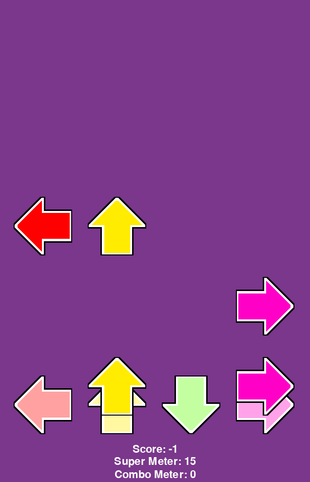

# Zird Rhythm Game

Rhythm game about tapping notes. Read more about it in DESIGN.md

## First Time Installation 

- Required `Python 3.11` or higher.   
- All commands should be ran in the `prakse-game` folder.  
- Run all commands `one by one` instead of copying the whole list.
### If you are on Windows (Powershell)
```
python -m venv .venv
.venv\Scripts\active.ps1
pip install -r requirements.txt
```
### If you are on Windows (Command Line)
```
python -m venv .venv
.venv\Scripts\active.bat
pip install -r requirements.txt
```
### If you are on MacOS or Linux
```
python -m venv .venv
source .venv/bin/activate
pip install -r requirements.txt
```

## Launch a Server

- Open a terminal in the `prakse-game` folder. It will stay open as long as you want your Server to be open for.
- If you **do not** see `(.venv)` on the **left side** for these commands, run .venv activation command **given in the earlier examples**, e.g. `.venv\Scripts\active.bat`.

### Run the following command
```
uvicorn api.main:app --reload
```

## Run the Game

- Open a `new` terminal in the `prakse-game` folder.

### Run the following command
```
python -m client.main
```

## Play the game

- For detailed instructions visit DESIGN.md.

## View your results in a **local** leaderboard

- Open https://localhost:8000/ to view the leaderboard


## REST API

| Method | Address                 | What does it do                                                           | Response  | 
|--------|-------------------------|---------------------------------------------------------------------------|-----------|
| POST   | `/scores`               | Save results in {"username": "username", "score": 123, "level": 2} format | 201       |
| GET    | `/scores/top`           | Returns the top 10 game results                                           | 200       |
| GET    | `/players/{name}/stats` | Returns player `username`, `bestScore` and `gamesPlayed`                  | 200 / 404 |

- Username has a 15 character limit, score wont be saved if it's negative. Data is stored locally in `/api/game.db`

## Example Game Screenshot

